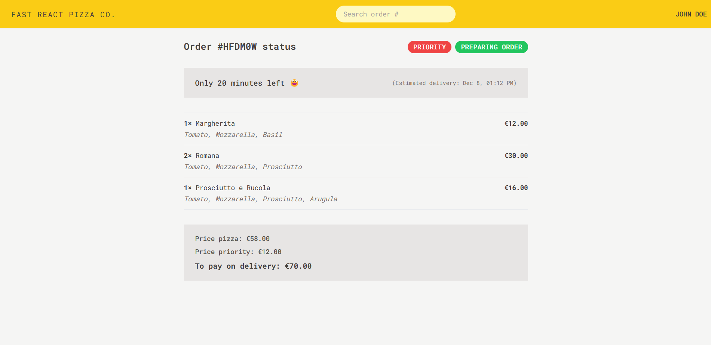

# Fast-React-Pizza-Co



A React learning application for browsing a pizza menu, managing a cart, placing demonstration orders, and updating priority status. It uses Redux Toolkit, React Router, and Tailwind CSS.

Learning project built while following [The Ultimate React Course](https://www.udemy.com/course/the-ultimate-react-course/) by Jonas Schmedtmann. The application concept and course design come from the course; this repository contains my course implementation. It is retained as learning work.

Hosted demo link (availability has not been verified):
[Fast-React-Pizza](https://reactpizza-abdousadik.netlify.app/)

## Table of Contents
- [Exercise Requirements](#exercise-requirements)
- [Technologies](#technologies)
- [Getting Started](#getting-started)
- [References](#references)

## Exercise Requirements

This application allows users to:

- Browse and order one or more pizzas from a menu.
- Use the app without creating an account or logging in.
  - Users simply input their name before ordering.
- View a dynamic pizza menu that is fetched from an API.
- Add multiple pizzas to a cart before placing an order.
- Provide their name, phone number, and address when ordering.
  - Optionally, users can provide their GPS location to simplify delivery.
- Mark their order as “priority” for an additional 20% of the cart price.
- Place orders via a POST request containing their user data and selected pizzas.
  - Payment is made upon delivery, so no in-app payment processing is required.
- Receive a unique order ID to track their order later.
- Mark their order as “priority” even after it has been placed.

## Technologies

The project is built with:

- **React**
- **Tailwind CSS**
- **React Router**
- **Redux**

## Getting Started

To run the project locally:

1. Clone the repository:
   ```bash
   git clone https://github.com/abdousadik/fast-react-pizza.git
   ```
2. Navigate to the project directory:
   ```bash
   cd fast-react-pizza
   ```
3. Install dependencies:
   ```bash
   npm ci
   ```
4. Start the development server:
   ```bash
   npm run dev
   ```

---

Back to [Top](#fast-react-pizza-co)

## References

[The Ultimate React Course — Jonas Schmedtmann](https://www.udemy.com/course/the-ultimate-react-course/)

Retained as course-based learning work. No independent commercial-product or production-readiness claim is made.
